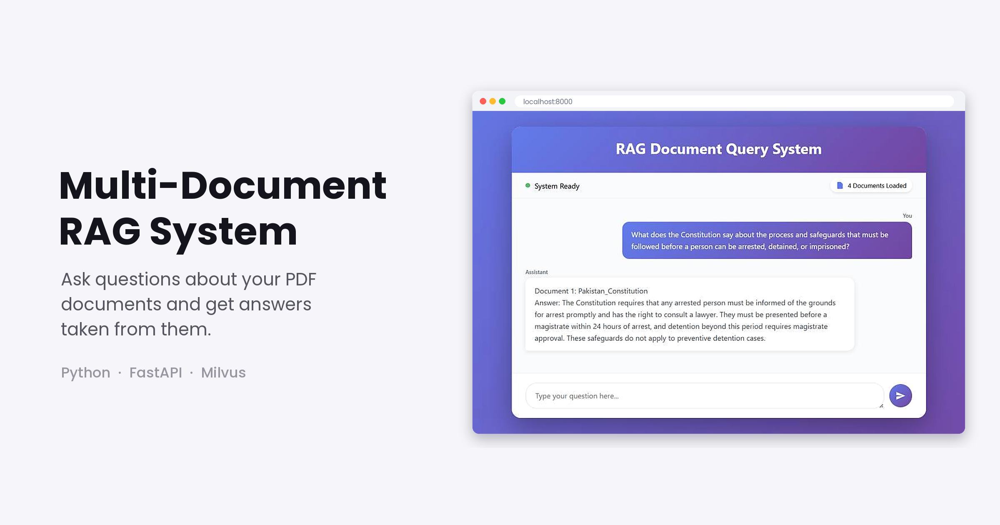
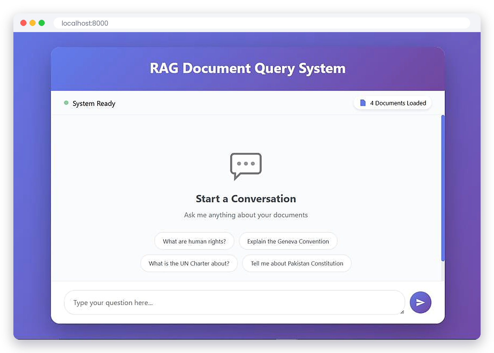
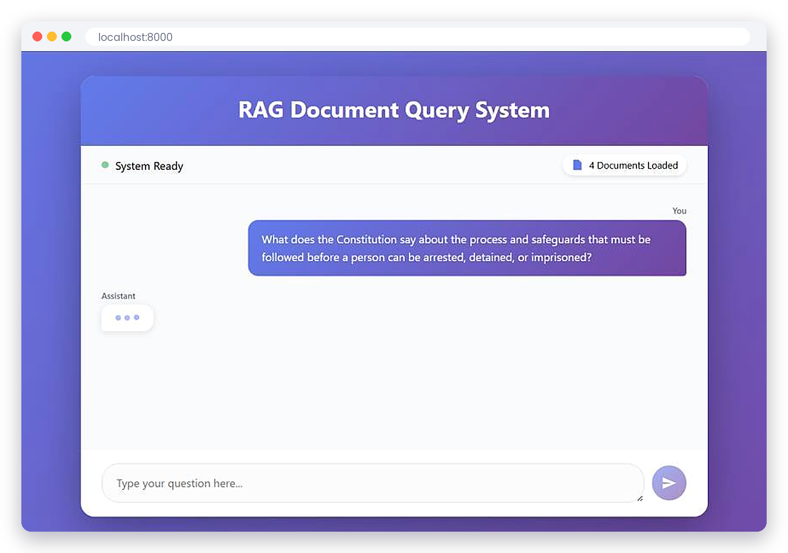
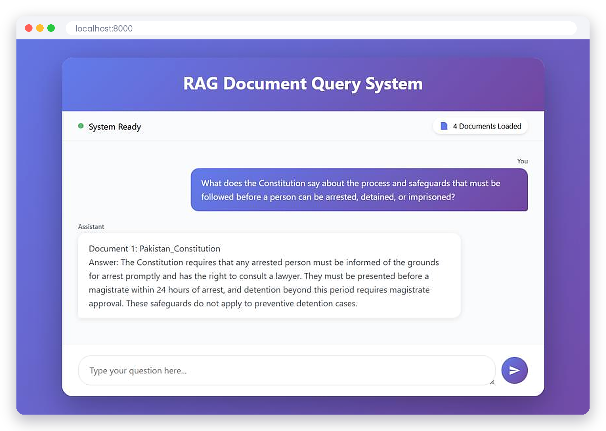
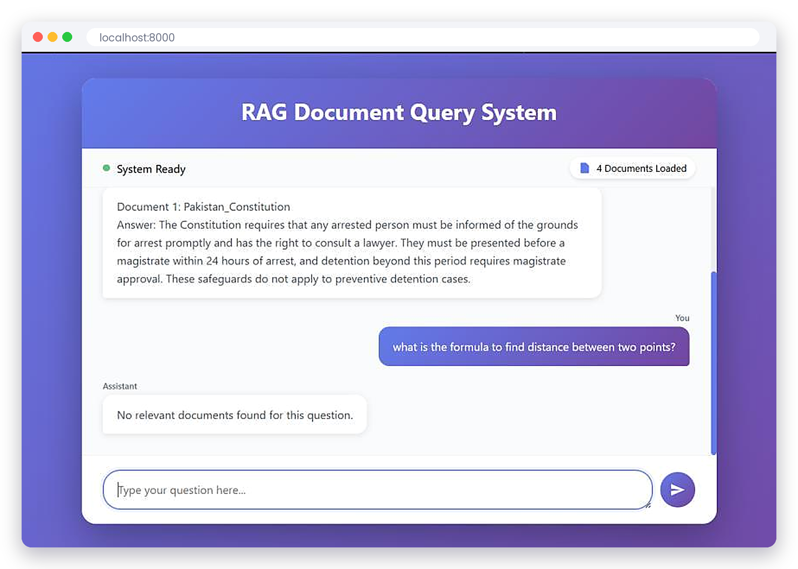
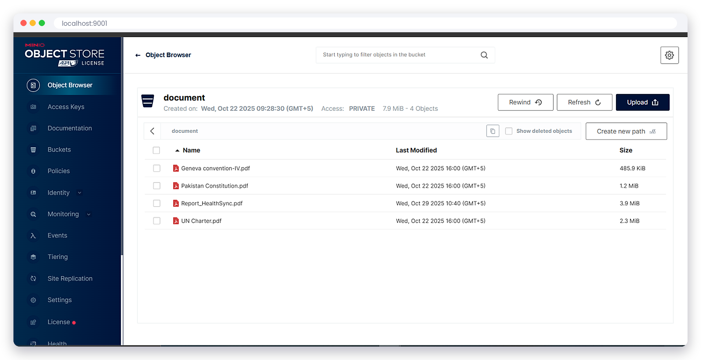

# Multi-Document RAG System

A question-answering system for PDF documents. You ask a question in a chat window and it finds the answer inside the documents, even when several PDFs are loaded at once. It was tested with the Pakistan Constitution, the UN Charter and the Geneva Convention IV.

## Features

- Searches several PDF documents with one question
- Uses only the documents that actually match the question; if more than one matches, it answers from each of them separately
- Says "No relevant documents found" for questions the documents can't answer
- Stores the document embeddings, so PDFs are only processed once
- Web chat page and a small REST API (`/api/query`, `/api/status`, `/api/health`)

## Screenshots

| Start page | Asking a question |
|---|---|
|  |  |

| Answer | Question not in the documents |
|---|---|
|  |  |

The PDFs are kept in a MinIO bucket:

## How it works

1. The PDFs are downloaded from MinIO, split into small chunks and turned into embeddings with the `intfloat/e5-large-v2` model. Each document is saved as its own collection in Milvus.
2. When a question comes in, it is compared with every document. Documents with a low similarity score are skipped.
3. If one document is clearly a better match than the others, only that one is used. Otherwise all matching documents are used.
4. The matching text is sent to the DeepSeek R1 model (through OpenRouter), which writes the answer using only that text.

## Built with

- Python, FastAPI
- LangChain
- Milvus (vector database) and MinIO, run with Docker
- Hugging Face embeddings (`e5-large-v2`)
- DeepSeek R1 through OpenRouter
- HTML, CSS and JavaScript for the chat page

The source code is kept in a private repository.
