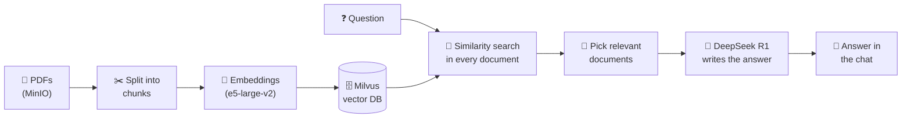

# Multi-Document RAG System

**Ask a question in plain English and get an answer taken straight from your PDF documents, even when they're spread across several files.**

## What it does

You load PDFs (for example a country's constitution, the UN Charter and the Geneva Conventions) and ask questions about them in a chat window. The system finds the most relevant passages, decides which documents actually contain the answer, and asks an AI model to answer **only from those passages**. If nothing relevant is found, it says so instead of making something up.

## Highlights

- 📚 **Several documents at once:** one question is searched across every PDF.
- 🎯 **Smart document selection:** if one document is clearly the best match, only that one is used; if several are equally relevant, each gets its own answer.
- 🚫 **No made-up answers:** unrelated questions get "No relevant documents found".
- ⚡ **Fast repeat starts:** document embeddings are stored in Milvus and reused, so PDFs aren't processed again.
- 💬 **Simple web chat** plus a REST API (`/api/query`, `/api/status`, `/api/health`).

## Screenshots

| Ready to chat | Asking a question |
|---|---|
|  |  |

| Answer from the right document | Unrelated question |
|---|---|
|  |  |

 The source PDFs live in a MinIO storage bucket

## How it works

1. **Indexing (once):** each PDF is downloaded from MinIO, split into 500-character chunks, turned into vectors with the `intfloat/e5-large-v2` model, and saved as its own Milvus collection.
2. **Searching:** the question is turned into a vector and compared with every document. Documents scoring below 0.60 similarity are ignored.
3. **Selecting:** if the best document beats the next one by more than 0.15, only the best one is used. Otherwise all relevant documents are kept.
4. **Answering:** the matching passages are sent to the DeepSeek R1 model (through OpenRouter) with an instruction to answer from that text only. The reply is cleaned up and shown in the chat.

## Tech stack

| Part | Technology |
|---|---|
| Backend & API | Python, FastAPI, Uvicorn |
| RAG pipeline | LangChain, PyPDF |
| Embeddings | Hugging Face `intfloat/e5-large-v2` (fallback: `all-MiniLM-L6-v2`) |
| Vector database | Milvus (Docker) |
| Document storage | MinIO (Docker) |
| Language model | DeepSeek R1 (via OpenRouter) |
| Frontend | HTML, CSS, JavaScript |

---

This repository is a showcase; the source code is kept private. Built by <a href="https://github.com/hassaan2077">Hassaan</a>.
